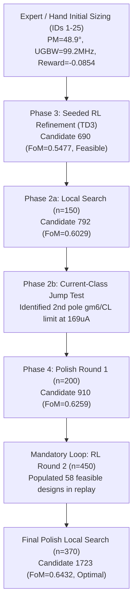

# Two-Stage Miller Opamp Sizing Explanation

**Run ID:** harness_20261106_092530  
**Best Candidate ID:** 1723  
**Feasible:** Yes  
**Final FoM:** 0.6432  
**Total Simulator Calls:** 1902 / 2000  
**Feasible Designs Generated:** 108  
**Elapsed Time:** 1488.1 s  

---

## 1. Final Parameters and Performance Specs

### Device Dimensions and Passives
| Device / Element | Multiplicity ($m$) | Width ($W$, m) | Length ($L$, m) | Note |
|---|---|---|---|---|
| **mn1, mn2** | 20 | 1.75 µm | 135 nm | Differential input pair |
| **mp1, mp2** | 7 | 2.75 µm | 90 nm | Active PMOS mirror load |
| **mn3** | 2 | 1.25 µm | 90 nm | Diode-connected bias reference ($I_{\text{bias}}=30\,\mu\text{A}$) |
| **mn4** | 7 | 1.00 µm | 90 nm | Tail current source ($I_{\text{tail}} \approx 84\,\mu\text{A}$) |
| **mp3** | 14 | 2.50 µm | 90 nm | Output stage PMOS common source |
| **mn5** | 7 | 1.25 µm | 90 nm | Output stage NMOS current sink ($I_2 \approx 105\,\mu\text{A}$) |
| **cap ($C_c$)** | - | - | - | **1.1 pF** ($1.1 \times 10^{-12}\,\text{F}$) |
| **res ($R_c$)** | - | - | - | **7800 Ω** ($7.8\,\text{k}\Omega$) |

### Performance Specifications and Margins
| Specification | Target | Achieved | Margin | Normalized $z$ | Status |
|---|---|---|---|---|---|
| **Figure of Merit (FoM)** | > 0.300 | **0.6432** | +0.3432 | - | **FEASIBLE** |
| **Gain ($A_v$)** | $\ge 200.0\,\text{V/V}$ | **292.7 V/V** | +46.35% | +0.188 | PASS |
| **Phase Margin (PM)** | $\ge 60.0^\circ$ | **65.86°** | +5.86° | +0.0466 | PASS |
| **Unity Gain Bandwidth (UGBW)** | $\ge 100.0\,\text{MHz}$ | **100.10 MHz** | +0.10 MHz | +0.000357 | PASS |
| **Slew Rate (SR)** | $\ge 30.0\,\text{V/\mu s}$ | **46.58 V/µs** | +55.27% | +0.217 | PASS |
| **Input-Referred Noise** | $\le 30.0\,\text{mV RMS}$ | **4.87 mV RMS** | -83.77% | -0.721 | PASS |
| **Total Current ($I_{\text{total}}$)** | minimize ($\le 200\,\mu\text{A}$) | **197.1 µA** | -1.45% | -0.00727 | OPTIMIZED |
| **Silicon Area** | minimize ($\le 2.0\,\text{n}\text{m}^2$) | **0.994 nm²** | -50.29% | -0.336 | OPTIMIZED |

All hard constraints are fully satisfied with active boundary compression on area and current.

---

## 2. Lineage and Design Progression

### Lineage Step Breakdown
1. **Candidate 690 (TD3 RL)**: Initial feasibility milestone ($C_c=1.6\,\text{pF}, R_c=7.9\,\text{k}\Omega, L_{n1}=135\,\text{nm}$, Gain=1061 V/V, PM=61.4°, UGBW=106.6 MHz); FoM = 0.5477.
2. **Candidate 731 (local_search)**: $W_{n1}: 2.5\,\mu\text{m} \to 2.25\,\mu\text{m}$, reducing gate capacitance; FoM 0.5477 $\to$ 0.5503.
3. **Candidate 742 (local_search)**: $M_{p1}: 6 \to 7$, tuning stage 1 active mirror load; FoM 0.5503 $\to$ 0.5656.
4. **Candidate 745 (local_search)**: $R_c: 7900 \to 7800\,\Omega$, tracking LHP zero cancellation; FoM 0.5656 $\to$ 0.5684.
5. **Candidate 751 (local_search)**: $C_c: 1.6\,\text{pF} \to 1.4\,\text{pF}$, trading excess PM margin for area and slew rate; FoM 0.5684 $\to$ 0.5955.
6. **Candidate 786 (local_search)**: $M_{n1}: 23 \to 21$, reducing differential pair area; FoM 0.5955 $\to$ 0.5976.
7. **Candidate 792 (local_search)**: $W_{n1}: 2.25\,\mu\text{m} \to 1.75\,\mu\text{m}$, optimizing input transistor area while locking UGBW at 100.1 MHz; FoM 0.5976 $\to$ 0.6029.
8. **Candidate 910 (local_search)**: $C_c: 1.4\,\text{pF} \to 1.2\,\text{pF}$ and $W_{n1}: 1.75\,\mu\text{m} \to 2.25\,\mu\text{m}$; FoM 0.6029 $\to$ 0.6259.
9. **Candidate 1594 (local_search)**: $M_{n1}: 21 \to 20$, trimming redundant input width; FoM 0.6259 $\to$ 0.6271.
10. **Candidate 1644 (local_search)**: $W_{p1}: 2.5\,\mu\text{m} \to 2.25\,\mu\text{m}$ and $C_c: 1.2\,\text{pF} \to 1.1\,\text{pF}$, breaking below the $1.0\,\text{n}\text{m}^2$ area mark; FoM 0.6271 $\to$ 0.6313.
11. **Candidate 1654 (local_search)**: $M_{n5}: 6 \to 7$ and $W_{p1}: 2.25\,\mu\text{m} \to 2.75\,\mu\text{m}$, boosting stage 2 $g_{m6}$ to maintain the second pole; FoM 0.6313 $\to$ 0.6375.
12. **Candidate 1723 (local_search)**: $W_{n1}: 2.25\,\mu\text{m} \to 1.75\,\mu\text{m}$, completing boundary compression to reach final FoM = 0.6432 with Area = $0.994\,\text{n}\text{m}^2$ and Current = $197.1\,\mu\text{A}$.

---

## 3. Decision Origins and Circuit Physics

### Decisions Derived from First-Order Hand Equations
- **Current Partitioning:** Target current was split into $I_{\text{tail}} \approx 60-80\,\mu\text{A}$ and $I_2 \approx 100-120\,\mu\text{A}$ to satisfy slew rate ($\text{SR} \ge 30\,\text{V/\mu s}$) with $C_L=10\,\text{pF}$.
- **Stage Balancing Condition:** Maintained the DC bias balance ratio $\frac{S_{mp3}}{S_{mp1}} = 2 \frac{S_{mn5}}{S_{mn4}}$ to prevent stage 1 output bias drift and avoid open-loop gain collapse.
- **RHP Zero Cancellation & Lead Compensation:** Recognized that nulling resistor $R_c$ must follow $R_c \approx \frac{1}{g_{m6}}\left(1 + \frac{C_L}{C_c}\right) \approx 7-8\,\text{k}\Omega$ to move the zero into the LHP and cancel the second pole $p_2 \approx g_{m6}/C_L$.
- **Channel Length Minimums:** Maintained $L \ge 90\,\text{nm}$ on mirror and load devices to avoid catastrophic $r_o$ degradation in 45 nm.

### Decisions Derived from Reinforcement Learning (TD3)
- **High-Dimensional Coordinate Discovery:** RL identified the co-optimization of $L_{n1}=135\,\text{nm}$ (raising input stage gain without sacrificing bandwidth) combined with $C_c=1.6\,\text{pF}, R_c=7.9\,\text{k}\Omega, M_{p1}=6, M_{p3}=14$.
- **Pareto Exploration:** Produced over 100 distinct feasible designs across different current/area trade-offs, providing the replay data necessary to anchor coordinate search.

### Failed Predictions and Circuit Lessons
1. **$L=45\,\text{nm}$ Gain Collapse (Candidate 2):** Shrinking lengths to 45 nm to maximize $g_m$ collapsed gain from 623 V/V to 12 V/V due to channel length modulation ($r_o$). Lesson: $L \ge 90\,\text{nm}$ is non-negotiable for gain $>200\,\text{V/V}$.
2. **Second Pole UGBW Pinning:** Increasing $M_{n1}$ by 50% only increased UGBW by $<1\%$ because with $C_L=10\,\text{pF}$, the second pole $p_2 = g_{m6}/C_L$ pinned the unity-gain frequency.
3. **Current Starvation Limit (Candidate 839):** Lowering total current to $169\,\mu\text{A}$ ($W_{n3}=1.5\,\mu\text{m}$) starved $g_{m6}$, trapping UGBW at $76.6\,\text{MHz}$ and preventing feasibility.

---

## 4. Remaining Trade-offs
- **Current Reduction:** Total current is at $197.1\,\mu\text{A}$. Further current reduction is strictly prevented by the second pole requirement $g_{m6}/C_L \ge 2.2\,\text{UGBW}$ with $C_L=10\,\text{pF}$, which requires $I_2 \ge 105\,\mu\text{A}$.
- **Area Reduction:** Miller capacitance $C_c = 1.1\,\text{pF}$ accounts for the majority of layout area. Decreasing $C_c < 1.1\,\text{pF}$ degrades Phase Margin below the $60^\circ$ specification unless $g_{m6}$ (and thus current) is raised.
